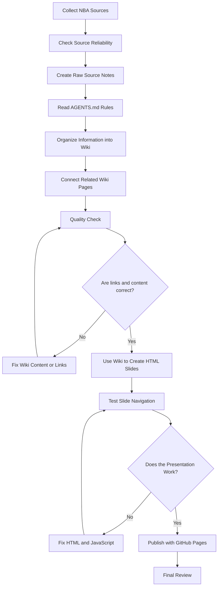

# NBA Team Wiki Workflow

## 1. Workflow Overview

This project uses an AI-assisted workflow to build and maintain an NBA knowledge base and generate an educational HTML presentation.

## 2. Workflow Diagram

## 3. Workflow Description

1. Collect five sources about NBA team management and analytics.
2. Record source information and create raw notes.
3. Follow AGENTS.md instructions to organize information.
4. Create five Wiki pages and connect related topics.
5. Check internal links, source links and content.
6. Use the Wiki as the knowledge base to create a 10-page HTML presentation.
7. Test navigation buttons and keyboard controls.
8. Publish the presentation using GitHub Pages.

## 4. Repeated Steps and Quality Checks

The workflow contains two feedback loops.

- Wiki loop: If content or links are incorrect, revise the Wiki and check again.
- Presentation loop: If slide navigation does not work, revise the HTML or JavaScript and test again.

These loops help ensure that errors are corrected before the final publication.
